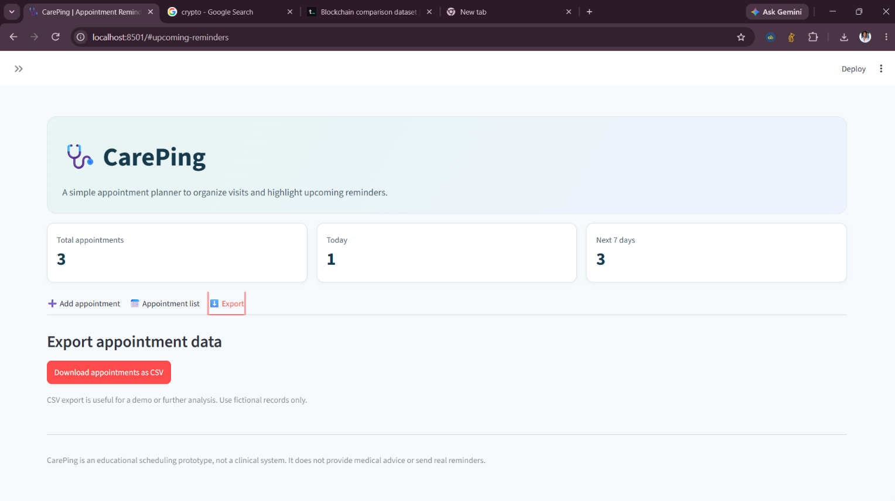
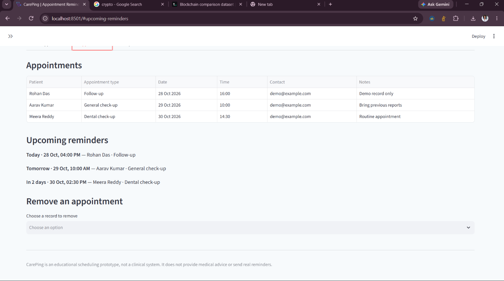

# CarePing — Healthcare Appointment Reminder

CarePing is a Python and Streamlit-based healthcare appointment management application designed to help users organize appointments, view upcoming schedules, and manage appointment records through a simple dashboard.

## Project Overview

Managing healthcare appointments manually can be difficult. CarePing provides a simple interface for adding appointments, viewing scheduled visits, tracking upcoming appointments, and exporting records.

This project was developed as a learning and demonstration project to practice Python programming, Streamlit UI development, data management, and GitHub project documentation.

## Features

- **Dashboard:** View total appointments, appointments scheduled for today, and appointments in the next seven days.
- **Add Appointments:** Enter and save appointment details through the application.
- **Appointment Records:** View saved appointments in an organized list.
- **Date and Time Sorting:** Display appointments in date-and-time order.
- **Sample Data:** Load fictional sample appointments for demonstration.
- **Remove Appointments:** Remove appointments from the displayed records.
- **CSV Export:** Export appointment records to a CSV file.
- **Simple Interface:** Use a clean, easy-to-understand Streamlit interface.

## Technologies Used

- Python
- Streamlit
- Pandas
- CSV
- Git and GitHub

## Screenshots

### Dashboard



### Appointments



### Records


### Create Appointment


## Project Structure

```text
CarePing-Healthcare-Appointment-Reminder/
├── app.py
├── requirements.txt
├── README.md
└── screenshots/
    ├── Dashboard.png
    ├── Appointments.png
    ├── Records.png
    └── create appointment.png
```

*Note: This structure assumes your main Streamlit file is named `app.py`. If your actual filename differs, update it here.*

## Installation and Setup

### 1. Clone the Repository

```bash
git clone YOUR_GITHUB_REPOSITORY_URL
```

Replace `YOUR_GITHUB_REPOSITORY_URL` with your actual GitHub repository URL.

### 2. Open the Project Folder

```bash
cd CarePing-Healthcare-Appointment-Reminder
```

### 3. Install Dependencies

```bash
pip install -r requirements.txt
```

### 4. Run the Application

```bash
streamlit run app.py
```

The application will usually open in your browser at:

`http://localhost:8501`

## How to Use

1. Start the application.
2. Open the dashboard to review appointment statistics.
3. Add appointment details using the appointment form.
4. View saved appointments in the records section.
5. Load fictional sample data to explore the application.
6. Remove appointments when required.
7. Export appointment records as a CSV file.

## Data and Limitations

- This is a demonstration and learning project.
- Appointment data is stored in Streamlit session memory and may not persist after the session ends or the app restarts.
- The application does not send real SMS, email, or push notifications.
- The application does not use a live AI model.
- Use fictional data for demonstrations. Do not enter real patient information.

## Learning Outcomes

Through this project, I practiced:

- Building an interactive application using Python and Streamlit.
- Creating dashboard metrics and displaying appointment records.
- Managing application data and working with CSV exports.
- Improving interface readability and usability.
- Organizing a project repository and documenting it with GitHub README Markdown.
- Testing application features and fixing issues through iterative development.

## Future Improvements

- Add persistent database storage.
- Implement configurable appointment reminder notifications.
- Add appointment search and filtering.
- Introduce secure user authentication.
- Improve validation and error handling.

## Author

**P M Jagan**

- GitHub: [Jagan1706](https://github.com/Jagan1706)
- LinkedIn: [Jagan PM](https://www.linkedin.com/in/jagan-pm-a8802b2a8)

## Disclaimer

CarePing is an educational demonstration project and is not intended to replace professional healthcare appointment systems.
